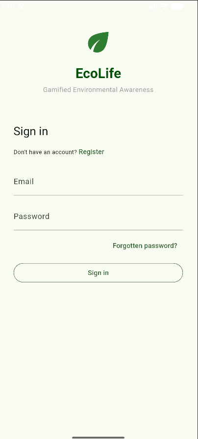
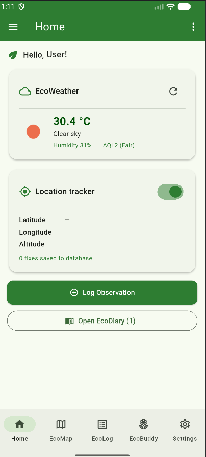
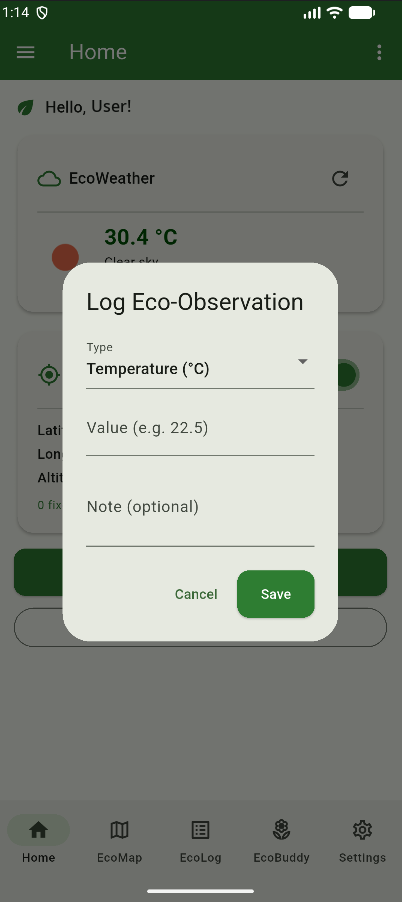
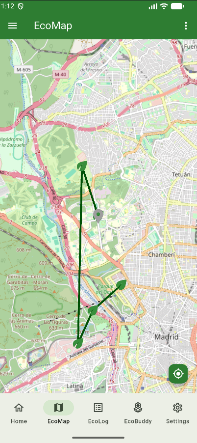
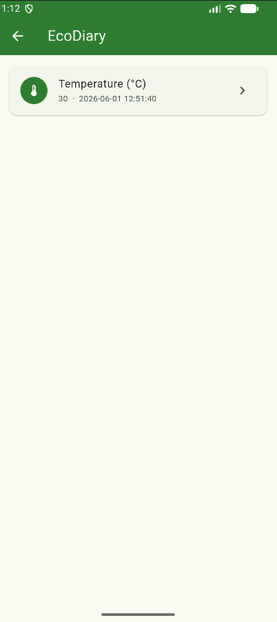
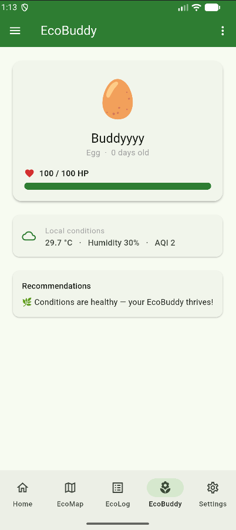
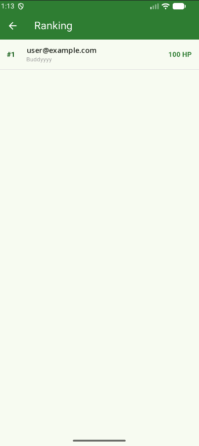
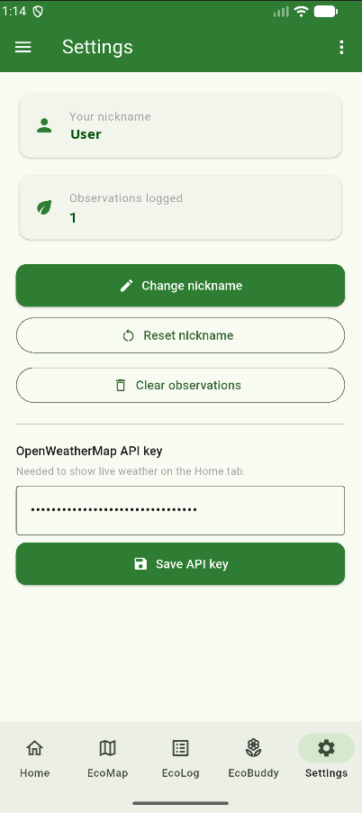

# EcoLife — Flutter

<p align="center">
  
</p>

Flutter port of a Kotlin Android app (MAD_EcoLife), the gamified
environmental awareness app built for the Mobile App Development course at UPM
(2026).

> **Final submission — v7.0 "EcoBuddy"** — all seven releases complete.

---

## Description

EcoLife is a gamified environmental awareness app. You raise a virtual
eco-creature — an **EcoBuddy** — whose health reflects the environmental quality
of your surroundings. The app tracks GPS location, logs environmental
observations, visualises eco-friendly green spaces on an interactive map, and
scores your EcoBuddy in real time from temperature, humidity, and air-quality
data via the OpenWeatherMap API.

EcoLife is inspired by the **Climate Cube** methodology: three categories of
environmental topics — **Red** (threats), **Yellow** (impacts on living things),
**Green** (solutions) — drive the game mechanics and recommendations.

---

## Screenshots

| Sign in | Home | Log observation | EcoMap |
|:-------:|:----:|:---------------:|:------:|
|  |  |  |  |

| EcoDiary | EcoBuddy | Ranking | Settings |
|:--------:|:--------:|:-------:|:--------:|
|  |  |  |  |

---

## Releases roadmap

| Tag  | Name                | Key features                                                               |
|------|---------------------|----------------------------------------------------------------------------|
| v1.0 | Hello EcoLife       | App setup, Material 3 theme, lifecycle logging, GPS permission, About screen |
| v2.0 | EcoTracker          | Location toggle, altitude tracking, CSV/file storage, 3-screen navigation  |
| v3.0 | EcoMap              | OpenStreetMap, user marker, 5 eco-POI markers, green polyline eco-trail    |
| v4.0 | EcoDiary            | AlertDialog, SharedPreferences, manual eco-observation logging, settings   |
| v5.0 | EcoLog & Navigation | Custom ListView, Navigation Drawer, Bottom Navigation, Toolbar             |
| v6.0 | EcoWeather & DB     | sqflite database, REST API (OpenWeatherMap), weather display               |
| v7.0 | EcoBuddy ✅          | Firebase Auth (email + Google), Realtime Database, EcoBuddy HP, ranking   |

---

## Features

**Core**

- Real-time GPS location tracking with on/off toggle
- Scrollable log of recorded GPS coordinates and manual observations
- Interactive OpenStreetMap with user marker, 5 eco-POI markers, eco-trail polyline
- Manual eco-observation diary (Temperature, Noise, Air Quality) via AlertDialog
- Live weather data via OpenWeatherMap REST API, persisted with sqflite
- EcoBuddy gamification screen with HP score derived from environmental data
- Global leaderboard via Firebase Realtime Database
- Email/password and Google sign-in via Firebase Authentication
- Dark mode support (Material 3, system-adaptive)

**Technical stack**

| Concern | Library |
|---|---|
| State management | `provider` |
| Location / sensors | `geolocator`, `permission_handler` |
| Maps | `flutter_map` (OpenStreetMap tiles), `latlong2` |
| Local persistence | `shared_preferences`, `sqflite` |
| Networking | `http` (OpenWeatherMap API) |
| Auth | `firebase_auth`, `firebase_ui_auth`, `firebase_ui_oauth_google` |
| Cloud database | `firebase_database` (Realtime Database) |
| Launcher icon | `flutter_launcher_icons` |

---

## Project structure

```
lib/
├── main.dart                       # Entry point — Firebase init + theme + routes
├── firebase_options.dart           # Placeholder — regenerate with FlutterFire CLI
├── core/
│   ├── constants.dart              # App-wide constants (Realtime DB URL placeholder)
│   ├── theme.dart                  # EcoLife green palette + Climate Cube colours
│   └── utils.dart
├── models/
│   ├── coordinate_model.dart
│   ├── eco_buddy_model.dart
│   ├── observation_model.dart
│   ├── ranking_entry.dart
│   └── weather_model.dart
├── services/
│   ├── database_service.dart       # sqflite (coordinates, observations, weather)
│   ├── location_service.dart       # geolocator wrapper
│   ├── prefs_service.dart          # shared_preferences wrapper
│   ├── realtime_service.dart       # Firebase Realtime Database (rankings)
│   └── weather_service.dart        # OpenWeatherMap REST API
├── routes/
│   └── app_routes.dart             # Named-route table
├── widgets/
│   ├── app_bar.dart
│   └── custom_button.dart
└── screens/
    ├── auth/auth_gate.dart         # Firebase auth state router
    ├── login/login_screen.dart     # Sign in / register (Firebase UI)
    ├── shell/main_shell.dart       # Bottom navigation shell
    ├── home/home_screen.dart       # GPS toggle + lifecycle log
    ├── ecomap/eco_map_screen.dart  # OpenStreetMap
    ├── ecodiary/eco_diary_screen.dart
    ├── ecolog/eco_log_screen.dart
    ├── detail/detail_screen.dart
    ├── ecobuddy/eco_buddy_screen.dart
    ├── ranking/ranking_screen.dart
    ├── settings/settings_screen.dart
    └── about/about_screen.dart
```

---

## Setup

### Prerequisites

- Flutter SDK ≥ 3.22
- Android SDK with a device or emulator (min API 23)
- Your own Firebase project with **Authentication** (email/password, optionally Google)
  and **Realtime Database** enabled
- [FlutterFire CLI](https://firebase.google.com/docs/flutter/setup)

### Connect Firebase

The original Firebase credentials are **not** included in this repository.
Before running, connect the app to your own Firebase project:

```bash
flutterfire configure   # regenerates lib/firebase_options.dart,
                        # android/app/google-services.json and
                        # ios/Runner/GoogleService-Info.plist
```

Then set `databaseUrl` in `lib/core/constants.dart` to your Realtime Database URL.

An OpenWeatherMap API key is entered at runtime in the Settings screen.

### Run

```bash
flutter pub get
flutter run
```

### Regenerate the launcher icon

```bash
python3 tool/gen_logo.py          # regenerate PNG source art (needs Pillow)
dart run flutter_launcher_icons   # resize + copy to all platforms
```

---

## Essential commands

| Command | Purpose |
|---|---|
| `flutter pub get` | Fetch dependencies |
| `flutter run` | Run on connected device/emulator |
| `flutter analyze` | Lint and static analysis |
| `flutter test` | Run unit and widget tests |
| `flutter build apk` | Build Android APK |
| `flutter build apk --release` | Build release APK |
| `flutter clean` | Remove build artifacts |
| `flutter doctor` | Verify development environment |
